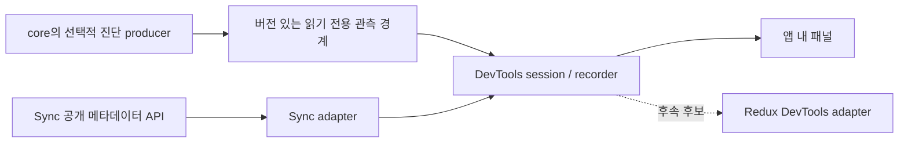

# DESIGN — state-ref DevTools

- 작성일: 2026-10-24. 상태: 앱 내 패널 우선 방향 확정, 구현 전 설계 초안.
- 기준: `412db01a63321eef3087f3bc04c46708447a29f8`. 브랜치: `feat/state-ref-devtools`.
- 연계: [REQUIREMENTS](./REQUIREMENTS.md), [IMPLEMENT](./IMPLEMENT.md), [MANUAL_TEST_CHECKLIST](./MANUAL_TEST_CHECKLIST.md).
- 체크 완료는 설계 선택을 뜻한다. 구현·검증 완료 표시가 아니다. 사용자 선택과 설계상 선택을 구분한다.

## 1. 결정 목록

- [x] **DC-DT-01 첫 UI — 앱 내 패널. 사용자 확정(U-DT-05).**
  - Zustand 방식의 Redux DevTools 어댑터는 현재 값·이력 UI를 재사용하는 장점이 있다. 대신 state-ref 구독 경로·실행 원인·Sync 메타데이터를 고유 화면으로 표현하기 어렵다.
  - 앱 내 패널은 별도 확장 설치 없이 프레임워크 공통으로 쓸 수 있고 위 정보를 함께 보여줄 수 있다. UI 유지 비용은 추가된다.
  - Vue DevTools 같은 특정 프레임워크 통합과 자체 브라우저 확장은 첫 범위에서 제외한다. Redux DevTools 어댑터는 후속 후보이며 이번 구현 계획에 포함하지 않는다.
  - 검증: T-DT-11, T-DT-13, M-DT-01, M-DT-08.
- [x] **DC-DT-02 공통 recorder와 UI 분리. 설계 선택.**
  - 후보 패키지는 `@stateref/devtools`, 브라우저 진입점은 `@stateref/devtools/panel`이다. 패키지 루트는 headless session/recorder를 제공한다.
  - core·sync·connectors가 UI 패키지를 역으로 import하지 않는다. 브리지·프로토콜 배치는 DC-DT-11에서 결정한다. 패키지 이름도 공개 전에 phase 0에서 export 충돌을 검사한다.
  - 검증: T-DT-10, T-DT-12, T-DT-14.
- [x] **DC-DT-03 명시적 등록과 소유권. 설계 선택.**
  - `attachStore(watch, { name })` / `attachSync(client, { name })` 후보를 사용한다. 기존 `createStore` 호출을 감싼 새 store factory로 교체하지 않는다.
  - 같은 session에서 같은 객체를 두 번 등록하면 두 번째 호출은 명확한 중복 오류로 거절한다. 같은 이름의 다른 객체는 ID로 구분한다. 서로 다른 session은 독립적으로 연결할 수 있다.
  - attach는 detach 함수를 반환한다. detach/dispose는 멱등이고 앱의 store·query handle을 dispose하지 않는다. 전역 자동 탐색은 없다.
  - 검증: T-DT-01, T-DT-09, T-DT-13, M-DT-06.
- [x] **DC-DT-04 성공한 commit의 진단을 기존 onWrite와 분리. 설계 선택.**
  - 기존 `onWrite`는 검증을 거쳐 commit 전에 실행되며 쓰기를 거절할 수 있다. 이를 바꾸거나 DevTools callback을 그대로 여기에 붙이지 않는다.
  - 새 계측은 commit 직후, 해당 쓰기가 subscriber를 실행하기 전에 진단 레코드를 만든다. 공개 listener 전달은 microtask로 미뤄 예외를 격리한다. listener를 commit 경로에서 직접 호출하지 않는다.
  - 거절된 쓰기에는 commit 이벤트가 없다. commit 뒤 subscriber 오류가 나도 이미 반영된 쓰기는 이력에 남는다.
  - 검증: T-DT-02, T-DT-03, T-DT-08.
- [x] **DC-DT-05 쓰기·batch·구독 실행을 다른 사건으로 기록. 설계 선택.**
  - 모든 성공한 setter를 보존한다. nested batch는 바깥 batch ID로 묶고 마지막 알림과 연결한다. batch 안에서 오류가 났다고 이미 성공한 setter를 롤백한 것으로 기록하지 않는다.
  - manual-sync 쓰기는 즉시 기록하지만 callback 실행은 실제 `sync()` 때 기록한다. 여러 쓰기와 알림의 관계는 cause 목록/그룹으로 표현한다.
  - 검증: T-DT-04, M-DT-03.
- [x] **DC-DT-06 표시 전용 값 표현. 설계 선택.**
  - 경로는 string/symbol segment 배열을 기본으로 하며 `NAVI` 문자열을 파싱하지 않는다. 같은 설명의 서로 다른 symbol은 session ID를 부여해 구분한다.
  - 저장값은 제한된 Preview 표현이다. getter·`toJSON`·사용자 serializer를 호출해 값을 펼치지 않는다. primitive와 plain data tree 외 값은 타입 표식으로 표시한다. 순환·생략·마스킹을 구별한다.
  - 사용자 Proxy 같은 임의 객체의 reflection 무부작용은 보장하지 않는다. 지원하는 plain tree 범위를 문서화하고 접근 오류를 표시 오류로 격리한다.
  - 검증: T-DT-05, T-DT-08, M-DT-02, M-DT-07.
- [x] **DC-DT-07 보관량 제한과 관측 공백 표시. 설계 선택.**
  - 초안 기본값: 이력 최대 200건이면서 직렬화된 Preview 포함 이력 합계 1 MiB 이하, 전달 대기 최대 1,000건. 하나의 값 Preview는 depth 6·노드 1,000개·UTF-8 64 KiB 중 먼저 닿는 한도로 자른다. 정확한 heap 크기를 보장하는 수치는 아니다.
  - 이력은 오래된 항목부터 제거한다. queue overflow는 drop 횟수와 gap을 남기고 현재값/구독 snapshot을 다시 읽는다. 완전한 이벤트 재생을 주장하지 않는다.
  - 마스킹은 저장 전에 적용하며 상태값을 localStorage에 남기지 않는다. pause 중 이력은 수집하지 않고 resume 시 현재값과 gap을 표시한다.
  - 검증: T-DT-08, T-DT-09, M-DT-06, M-DT-07.
- [x] **DC-DT-08 구독 실행 이유만 설명. 설계 선택.**
  - core의 실제 구독 ID·현재 경로·실행 횟수·변경이 확인된 경로를 사용한다. 경로가 후보였다는 이유만으로 callback 실행을 기록하지 않는다.
  - 컴포넌트명은 자동 추정하지 않는다. 첫 버전은 `subscription #id`를 사용한다. 프레임워크 commit/render 횟수와 구별해 화면에 표시한다.
  - 검증: T-DT-06, T-DT-13, M-DT-04.
- [x] **DC-DT-09 Sync는 기존 메타데이터 경계 준수. 설계 선택.**
  - 네 공개 메서드만 이용한다: `inspectCache`, `subscribeCache`, `inspectMutations`, `subscribeMutations`. query를 새로 열어 payload를 가져오지 않는다.
  - 종료 작업 이력은 도구가 소유한다. `owners === 0`을 캐시 삭제/누수로 해석하지 않으며 관측 phase를 서버 성공·재전송 허가로 해석하지 않는다.
  - 검증: T-DT-07, M-DT-05.
- [x] **DC-DT-10 브라우저 패널은 명시적 mount. 설계 선택.**
  - 후보 구현은 작은 DOM renderer와 ShadowRoot다. 호스트 앱에 React/Vue 런타임을 추가하지 않는다. 스타일·이벤트·접근성을 별도 검증한다.
  - 패널 진입점도 import만으로 document/window를 읽거나 DOM을 만들지 않는다. mount는 브라우저에서만 호출하고 잘못된 host는 명확한 오류로 알린다.
  - 검증: T-DT-11, T-DT-12, M-DT-01, M-DT-08.
- [ ] **DC-DT-11 코어 관측 브리지의 공개 계약 — TBD, phase 0에서 닫는다.**
  - 비교안 A: `state-ref/devtools` 진입점과 소유 코어가 제공하는 버전 있는 관측 프로토콜. 비교안 B: `state-ref/plugin`에 좁은 관측 API를 추가한다.
  - 기존 private tuple을 UI에서 직접 해석하거나 `create`/`pathRoot`에 의존하는 방식은 채택하지 않는다. 어느 안이든 root store의 읽기 전용 snapshot/이벤트/해제를 제공하고 기존 ref를 만든 뒤 attach해도 기록돼야 한다.
  - 일반 `createStore`와 manual-sync root watch가 필수 대상이다. computed/combineWatch/지연 shared watch는 capability 검사로 거절한다. shared에 등록된 **원래 watch**는 소유 번들에서 붙일 수 있어야 한다.
  - 다른 코어 사본이 만든 일반 watch를 지원할지, 프로토콜 불일치를 어떻게 거절할지는 2-copy fixture로 결정하고 지원표에 명시한다. 다른 realm은 제외한다.
  - 종료 기준: attach 전후 호출 순서·기존 ref 관측·subscribe snapshot·protocol mismatch·미연결 비용의 실험 결과와 공개 타입 초안을 기록한다. 생산 코드 구현 전 결정한다.
  - 검증: T-DT-01, T-DT-02, T-DT-06, T-DT-10, T-DT-12, T-DT-13.
- [ ] **DC-DT-12 활성화 비용·패키지 호환 버전 — TBD, phase 0에서 닫는다.**
  - baseline Node/pnpm과 동일 조건에서 미연결·연결 후 기록·패널 표시를 각각 측정한다. core 3,800 B cap과 기존 bench 기준은 유지한다.
  - 측정 workload: 깊이 8/32 읽기, 1,600 idle 구독에 대한 500회 쓰기, 10,000회 연속 쓰기에서 queue/이력/메모리 상한, 열기/닫기 20회. 새 UI gzip 크기도 따로 기록한다.
  - 종료 기준: 반복 median/p95 측정 방법과 활성화 비용의 수치 목표를 고정하고, 새로운 브리지를 요구하는 최소 core 버전 및 peer range를 정한다. 초과 시 설계를 줄이며 조용히 cap을 올리지 않는다.
  - 검증: T-DT-00, T-DT-08, T-DT-10, T-DT-13, M-DT-06.

## 2. 구조와 책임



| 계층 | 책임 | 하지 않는 일 |
|---|---|---|
| 코어 producer/bridge | commit·구독 실행·해제 시점 계측, 현재 snapshot, 미연결 fast path | 이력 UI, 값 편집, stack 수집, 원격 전송 |
| recorder | session ID, bounded history, Preview·마스킹·필터, 진단 상태, 수명 | 새 앱 구독 생성, store/query 소유권 획득 |
| Sync adapter | client별 초기 snapshot과 두 이벤트 스트림 연결 | cache warm-up, refetch, mutation 재실행 |
| panel | 현재 상태·이력·구독·Sync 탭과 검색·pause·clear | 앱 상태 수정, 스토어 복원, 서버 작업 실행 |

코어 브리지 이외의 대부분 구현은 신규 `packages/devtools/` 후보에 둔다. 코어 계측은 `core`, `proxy`, `connectors/collector`, `connectors/runner`, `batch`에 최소한으로 들어갈 수 있다. 기존 draft/plugin journal은 그대로 두며 Sync 내부 계측을 추가하지 않는 것이 첫 안이다. 관련 예제와 소비자 번들 검증은 `examples/`와 `scripts/`의 기존 장치를 확장한다.

## 3. 이벤트와 snapshot 계약

이름은 아직 공개된 API가 아닌 설계 어휘다. 정확한 export/type 선언은 DC-DT-11의 산출물로 확정한다.

| 레코드 | 필수 정보 | 의미 |
|---|---|---|
| store-attached | source ID, name, capability, 관측 시작 시점 | attach 전 기록은 없다. 기존 구독은 현재 snapshot으로만 보인다. |
| write | source sequence, event ID, path, before/after Preview, optional batch ID | 성공한 직접 대입. action 이름 대신 경로를 기본 표시한다. |
| subscription snapshot | subscription ID, 현재 dependencies | attach 시점과 queue gap 뒤의 현재 상태. 과거 subscribe 시점은 추정하지 않는다. |
| subscription-run | subscription ID, changed paths, cause IDs/group 또는 unknown | 실제 callback 호출. 초기 실행은 update와 구분한다. |
| subscription-ended | subscription ID | 이후 읽기로 구독이 되살아나지 않는 기존 계약을 보존한다. |
| sync-cache / sync-mutation | client ID, 기존 public event의 메타데이터 | source별 이벤트 순서는 보존하되 코어와 Sync의 인과관계를 시각만으로 만들지 않는다. |
| diagnostic / gap | 종류, 누락 건수 또는 범위, 복구 상태 | capture 실패·queue overflow·pause·미지원 protocol을 숨기지 않는다. |

- 현재값 snapshot과 이력은 별개다. 선택한 store의 현재값은 요청 시 읽고, 이력은 해당 쓰기의 before/after를 보관한다. 매 쓰기마다 모든 store의 전체 트리를 복제하지 않는다.
- Preview는 JSON 문자열화에 의존하지 않는 tagged value다. `undefined`, `NaN`, bigint, symbol, 누락, 잘림을 서로 구분한다. symbol ID와 경로 표식은 보존하되 원본 객체를 외부 listener에 넘기지 않는다.
- commit 직후 before/after의 제한된 표현을 확정해야 재진입 쓰기가 과거 값을 바꾸지 않는다. 사용자 callback 없는 캡처를 기본으로 하며 실패하면 진단만 남긴다. 임의 raw object 직접 변경은 setter 이벤트로 추적되지 않는다.
- source별 sequence와 session 수신 sequence를 구분한다. Sync 이벤트는 이미 microtask에서 전달되므로 다른 source와의 정확한 발생 순서를 wall clock으로 보장하지 않는다.
- runner의 기존 비교에서 바뀐 것으로 확인한 경로를 사용한다. DevTools 때문에 getter를 추가 실행하거나 판정 순서를 바꾸지 않는다. 알 수 없는 원인은 `unknown`으로 표시한다.
- read dependency는 collector가 실제 관리하는 집합이다. `trackDeps: false`에서는 경로가 누적될 수 있고, `true`에서는 재수집 및 예외 시 복구 결과를 그대로 표시한다.

## 4. 수명과 사용 예시

아래 코드는 **제안 API**이며 현재 설치된 state-ref에서는 실행되지 않는다. 최종 시그니처를 확정한 뒤 문서 예제 컴파일 검증에 편입한다.

```ts
// 후보 형태: 앱의 개발용 bootstrap에서만 실행
const tools = createDevtools({ maxEvents: 200, maxHistoryBytes: 1_048_576 });
const detachStore = tools.attachStore(watch, { name: 'cart' });
const detachSync = tools.attachSync(client, { name: 'api' });
const unmount = mountPanel(tools, { target: document.body });

// 개발 앱/HMR 수명이 끝날 때
unmount();
detachSync();
detachStore();
tools.dispose();
```

| 동작 | 기록 | 앱 | 도구 자원 |
|---|---|---|---|
| 패널 접기 | 계속 | 그대로 | DOM 갱신을 멈추고 명시적인 기록 중 표시를 남긴다. |
| pause / resume | pause 구간 생략, resume snapshot | 그대로 | pending queue를 비우고 gap 기록. |
| clear | 과거 이력만 삭제 | 그대로 | 현재 snapshot과 등록은 유지. |
| unmount | session이 살아 있으면 계속 | 그대로 | panel listener·DOM·예약 렌더 제거. |
| detach | 해당 source의 수집 종료 | dispose하지 않음 | bridge listener·pending source 참조 제거. 기존 Preview 이력은 한도 내 유지. |
| tools.dispose | 모두 종료 | dispose하지 않음 | 모든 listener·queue·ID registry·snapshot·이력·연결된 panel 제거. |

모든 view는 recorder를 관측하며 앱의 `watch`를 재사용해 자신을 그리지 않는다. source teardown과 UI repaint를 섞어 화면이 멈춘 상태를 정상 결과로 오인하지 않게 한다. disposed session에 새 attach는 오류로 거절하고, 이미 해제된 callback은 무시한다.

## 5. 패널 정보 구조

1. 대상 목록: 등록 이름 + ID + 종류(core/sync), 연결 상태. 이름이 같아도 합치지 않는다.
2. 상태 탭: 선택한 core store의 현재 Preview와 경로 검색. 새 값 읽기와 pause 중인 이력을 구분한다.
3. 이력 탭: write 목록, 경로·전후 차이, batch 그룹, 관측 공백. 선택은 표시만 바꾸고 앱 상태를 복원하지 않는다.
4. 구독 탭: subscription ID, 경로 집합, update 실행 횟수, 마지막 cause. '컴포넌트 렌더 횟수'라는 이름을 사용하지 않는다.
5. Sync 탭: query key, kind, owners, status/fetchStatus, dirty/conflicts/unconfirmed, mutation phase/attempt/linkedKeys와 관측한 종료 이력. payload·오류 원문은 미지원으로 설명한다.

키보드로 열기/닫기/탭/검색/이력 선택이 가능해야 한다. focus를 패널 안에 가두지 않으며 닫으면 실행한 버튼으로 돌려준다. 긴 값·좁은 화면·앱의 강한 전역 CSS를 M-DT-08에서 확인한다.

## 6. 남은 결정과 진행 조건

UI 방향 DC-DT-01은 사용자 답변으로 닫혔다. DC-DT-11·DC-DT-12는 공개 API/성능을 측정 없이 확정하지 않기 위한 기술 과제이며 phase 0에서 실험과 문서 개정으로 닫는다. 별도의 사용자 승인을 전제하는 게이트가 아니다. 결과가 사용자 확정 방향이나 기존 동작을 바꿔야 할 때만 변경 내용을 설명하고 방향을 협의한다.

세부 UI 예제·패키지 버전·공개 타입을 구현 전에 네 문서에 반영한다. IMPLEMENT의 단계 1 이후는 이 두 결정이 닫힌 상태에서 진행한다.
